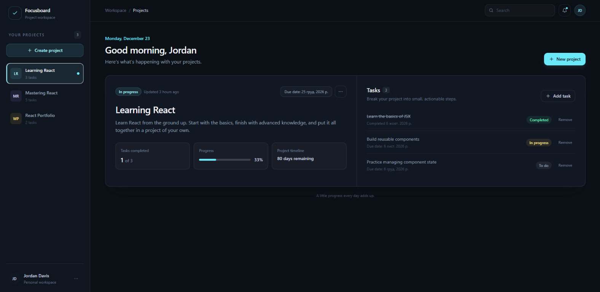
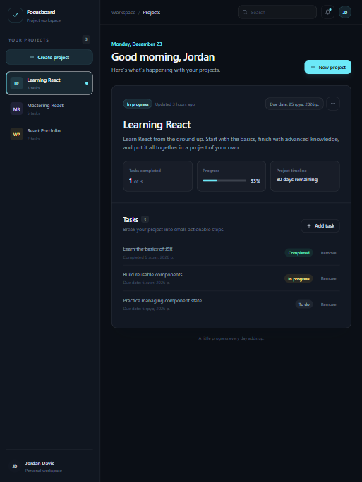
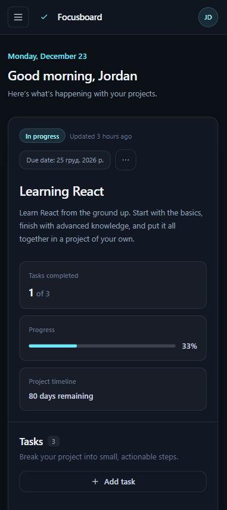

# Project Management

[](https://github.com/oleh-kazban/project-management/actions/workflows/ci.yaml)
[](https://github.com/oleh-kazban/project-management/actions/workflows/pr-validation.yaml)

A project management app built with React, TypeScript, Vite, and Tailwind CSS. It includes a project dashboard with project details and metrics, plus task creation, removal, and status updates.

## Screenshots

### Desktop



### Tablet and mobile

| Tablet                                                 | Mobile                                                 |
| ------------------------------------------------------ | ------------------------------------------------------ |
|  |  |

## Prerequisites

- Node.js
- pnpm 12.10.1

## Getting started

Install dependencies and start the development server along with the mock API server:

```sh
pnpm install
pnpm start
pnpm start:api
```

Vite prints the local development URL in the terminal.

## Available scripts

| Command                   | Description                                                       |
| ------------------------- | ----------------------------------------------------------------- |
| `pnpm start`              | Start the Vite development server via Nx.                         |
| `pnpm start:api`          | Start the json-server mock API on port 3000.                      |
| `pnpm build`              | Create a production build in `dist/` with Nx computation caching. |
| `pnpm preview`            | Preview the production build locally.                             |
| `pnpm test`               | Run unit tests across projects.                                   |
| `pnpm test:affected`      | Run tests only for affected projects relative to `master`.        |
| `pnpm lint`               | Lint projects with ESLint via Nx.                                 |
| `pnpm lint:affected`      | Lint only projects affected relative to `master`.                 |
| `pnpm lint:fix`           | Run ESLint and apply available automatic fixes.                   |
| `pnpm check:cycles`       | Check for circular dependencies in `src/`.                        |
| `pnpm format`             | Format all project files with Prettier via Nx.                    |
| `pnpm format:uncommitted` | Format only uncommitted files with Prettier via Nx.               |
| `pnpm format:check`       | Check formatting without changing files.                          |
| `pnpm dep-graph`          | Open the interactive Nx dependency graph.                         |

## Pre-commit checks

Husky runs the following commands before each commit (with `NX_DAEMON=false` to ensure fast subshell execution):

```sh
pnpm nx affected -t lint:fix
pnpm format:uncommitted
```

These commands apply automatic lint fixes to affected code and format only uncommitted files. Review and stage any resulting changes before committing.

## Pre-push checks

Husky runs `pnpm check:cycles` before each push. It uses Madge to check TypeScript and TSX modules in `src/` for circular dependencies. Run the command directly at any time:

```sh
pnpm check:cycles
```

## Import ordering

ESLint enforces import groups in this order, with a blank line between groups:

1. React imports.
2. Other third-party imports.
3. Application imports, including relative paths.

## Project structure

```text
.
├── public/                 # Static assets
├── src/
│   ├── assets/             # Source assets
│   ├── constants/          # Application constants
│   ├── features/           # Feature-based modules (Project, Task management)
│   ├── layout/             # Layout components
│   ├── types/              # TypeScript definitions
│   ├── ui/                 # Reusable UI components
│   ├── utils/              # Helper functions
│   ├── App.tsx             # Root application component
│   ├── index.css           # Global styles
│   └── main.tsx            # Application entry point
├── eslint.config.js        # ESLint flat configuration
├── index.html              # Vite HTML entry
├── nx.json                 # Nx workspace configuration & target defaults
├── package.json
├── pnpm-lock.yaml
├── project.json            # Nx project targets definition
├── tailwind.config.js
└── vite.config.js
```
